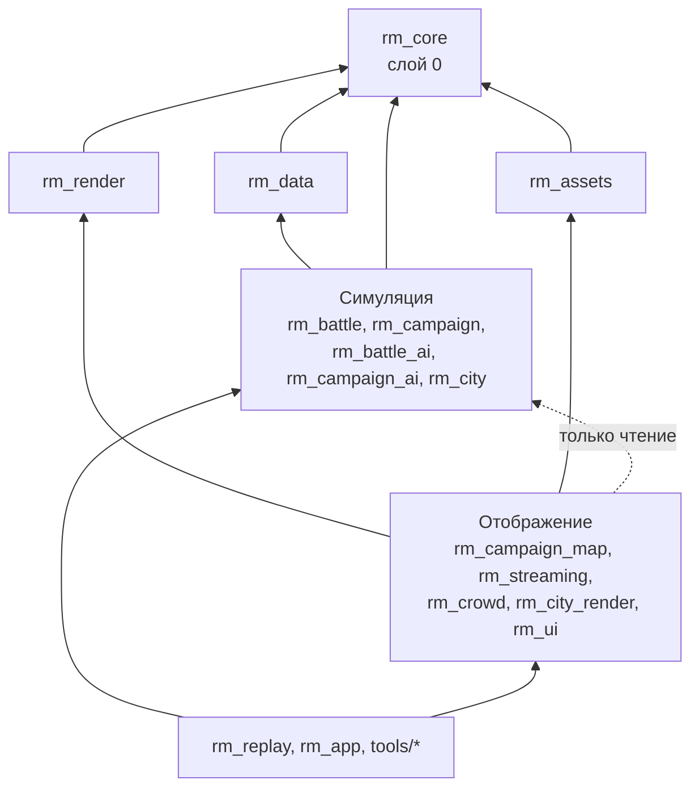

# Карта крейтов и границы модулей

- **Статус:** Принято
- **Дата:** 2026-10-14
- **Владелец:** Оркестратор
- **Затрагивает:** все крейты в `crates/`, утилиты в `tools/`

## Коротко

Проект — это один Cargo workspace, разбитый на небольшие крейты (библиотеки Rust). Каждый крейт принадлежит одному агенту. Крейты разложены по слоям, и зависеть можно только от слоёв ниже. Главное правило: **симуляция никогда не зависит от рендера**. Благодаря этому бой и кампанию можно запускать без окна и видеокарты: в тестах, в реплеях, на CI.

## Контекст

Над проектом параллельно работают до 22 агентов. Если границы не зафиксировать сразу, крейты начнут ссылаться друг на друга по кругу, а симуляция начнёт читать данные рендера. Тогда сломаются детерминированные реплеи ([determinism.md](determinism.md)) и невозможно будет мерить бюджеты по подсистемам ([budgets.md](budgets.md)).

## Решение

### Слои

Стрелка «A → B» значит «A зависит от B».

| Слой | Что в нём | Может зависеть от |
|---|---|---|
| 0. Ядро | `rm_core` | только внешних крейтов из разрешённого списка |
| 1. Фундамент | `rm_data`, `rm_assets`, `rm_render` | слоя 0 |
| 2а. Симуляция | `rm_battle`, `rm_campaign`, `rm_battle_ai`, `rm_campaign_ai`, `rm_city` | слоёв 0–1, **кроме `rm_render` и `rm_assets`** |
| 2б. Отображение | `rm_campaign_map`, `rm_streaming`, `rm_crowd`, `rm_city_render`, `rm_ui` | слоёв 0–1 и крейтов симуляции (только на чтение их публичных снимков состояния) |
| 3. Сборка | `rm_replay`, `rm_app`, утилиты в `tools/` | всего ниже |

### Крейты и владельцы

| Крейт | Назначение | Владелец | Этап |
|---|---|---|---|
| `rm_app` | Исполняемый файл игры: окно, ввод, главный цикл, связывание подсистем | Каркас приложения (Q4) | 0–1, есть |
| `rm_core` | ECS, планировщик задач (job system), аллокаторы, фиксированный шаг времени, детерминированная математика и ГСЧ | C1 | 1, есть |
| `rm_data` | Парсеры текстовых файлов M2, схемы, валидация, горячая перезагрузка, наложение модов | C3 | 1, есть |
| `rm_assets` | Рантайм-форматы ассетов: атласы, запечённые анимации, LOD-цепочки, манифесты пакетов | C2 | 1 |
| `rm_render` | Обёртка над Vulkan: устройство, кадры в полёте, буферы, пайплайны, instancing, батчинг | D1 (совместно с D4) | 2 |
| `rm_campaign` | Правила кампании: поселения, постройки, экономика, агенты, религия, порядок хода | D8 | 2 |
| `rm_campaign_map` | Рендер карты кампании: heightmap, lightmap, stencil-границы, splatting | D1 | 2 |
| `rm_battle` | Боевая симуляция: движение, цилиндрические хитбоксы, soft collision, строи, мораль, снаряды | D3 | 3 |
| `rm_crowd` | Рендер юнитов: GPU instancing, анимация из текстур, LOD, импосторы | D4 | 3 |
| `rm_battle_ai` | Тактический ИИ: генерал → отряд | D7 | 3 |
| `rm_campaign_ai` | ИИ кампании и кластерная дипломатия | D6 | 4 |
| `rm_ui` | Интерфейс битвы и кампании, UI-атласы | D10 | 4 |
| `rm_city` | Мегаполисы: сборка застройки, многоуровневый navmesh, стены и ворота (без рендера) | D5 | 5 |
| `rm_city_render` | Рендер мегаполисов: instancing зданий, occlusion culling, LOD | D5 | 5 |
| `rm_streaming` | Virtual Texturing, Quadtree-стриминг, Geometry Clipmaps | D2 | 6 |
| `rm_replay` | Запись и воспроизведение реплеев, проверка расхождений | Q1 | 3 |
| `tools/rm_assetc` | Офлайн-сборщик ассетов (атласы, запекание, нарезка мега-текстуры) | C2 | 1 |
| `tools/rm_modcheck` | Проверка мода: разбирает все текстовые файлы и печатает ошибки | C3 + G3 | 1 |
| `benches/` | Эталонные сцены и бенчмарки | Q2 | 3 |

Контент фракций (D9) — это не крейт, а текстовые файлы в `data/`.

Крейты, которых ещё нет, создаёт их владелец на своём этапе. Имя и слой берутся из этой таблицы. Новый крейт, которого нет в таблице, требует правки этого ADR.

### Правила границ

1. **Симуляция не видит рендер.** Крейты слоя 2а не зависят от `rm_render`, `rm_assets`, `ash`/`vulkan` и оконных библиотек. Они компилируются и тестируются без видеокарты.
2. **Отображение читает симуляцию, но не пишет в неё.** Рендер получает от симуляции снимок состояния (например, SoA-буфер позиций юнитов), а изменения в мир идут только через команды (см. [determinism.md](determinism.md)).
3. **Соседи по слою не зависят друг от друга напрямую, кроме перечисленных пар.** Разрешено: `rm_battle_ai → rm_battle`, `rm_campaign_ai → rm_campaign`, `rm_battle → rm_city` (навигация в городе), `rm_city_render → rm_crowd`, `rm_campaign_map → rm_streaming` (карта рисуется поверх виртуальной текстуры). Обратные направления запрещены. Остальное — через типы в нижнем слое или через `rm_app`.
4. **Игровые данные приходят только из `rm_data`.** Ни один крейт не читает файлы `data/` сам и не хранит игровые числа в коде ([modding-contract.md](modding-contract.md)).
5. **Публичный API крейта — его контракт.** Ломающее изменение публичного типа, которым пользуется другой крейт, требует согласия владельца крейта-потребителя.
6. **Внешние зависимости — по списку.** Новую внешнюю библиотеку добавляет владелец крейта с одной строкой обоснования в PR. Тяжёлые движки (физические, игровые) запрещены, см. [smart-hacks.md](smart-hacks.md).

### Внешние крейты, согласованные на старте

| Назначение | Крейт | Где можно |
|---|---|---|
| Vulkan | `ash` | только `rm_render` |
| Окно и ввод | `winit` | `rm_app`, `rm_render` |
| Аллокатор видеопамяти | `gpu-allocator` | только `rm_render` |
| Математика | `glam` | везде, но в симуляции только через обёртки `rm_core` (см. детерминизм) |
| Ошибки | `thiserror` (библиотеки), `anyhow` (только `rm_app` и `tools/`) | — |
| Логи и профилирование | `tracing` | везде |

## Почему не иначе

- **Один большой крейт.** Проще на старте, но агенты будут постоянно мешать друг другу, а время компиляции станет большим.
- **Готовый движок (Bevy и подобные).** Он навязывает свой рендер и свою модель ECS, а цель проекта — реконструировать архитектуру M2 своими руками и держать бюджеты под контролем.
- **Рендер внутри крейтов симуляции.** Удобно, но тогда симуляцию нельзя запускать без GPU, а реплеи зависят от драйвера.

## Последствия

- Каждый агент может собирать и тестировать свой крейт отдельно: `cargo test -p rm_battle`.
- Нужен небольшой слой «снимков состояния» между симуляцией и рендером. Это осознанная цена.
- CI (Q4) должен проверять правила границ автоматически.

## Как проверяем

- На CI запускается проверка графа зависимостей (`cargo metadata` + скрипт или `cargo-deny` с запретами): крейт слоя 2а, зависящий от `rm_render`, `rm_assets`, `ash` или `winit`, валит сборку.
- Крейты симуляции собираются и проходят тесты в CI-контейнере без GPU.
- Код-ревьюер (Q3) проверяет правило 4: числа баланса в коде вместо данных — замечание, блокирующее слияние.
