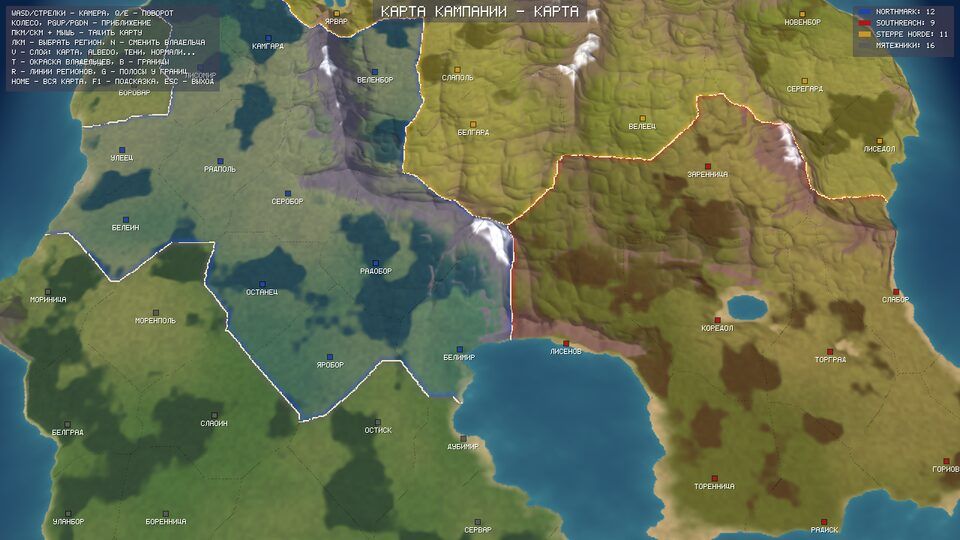
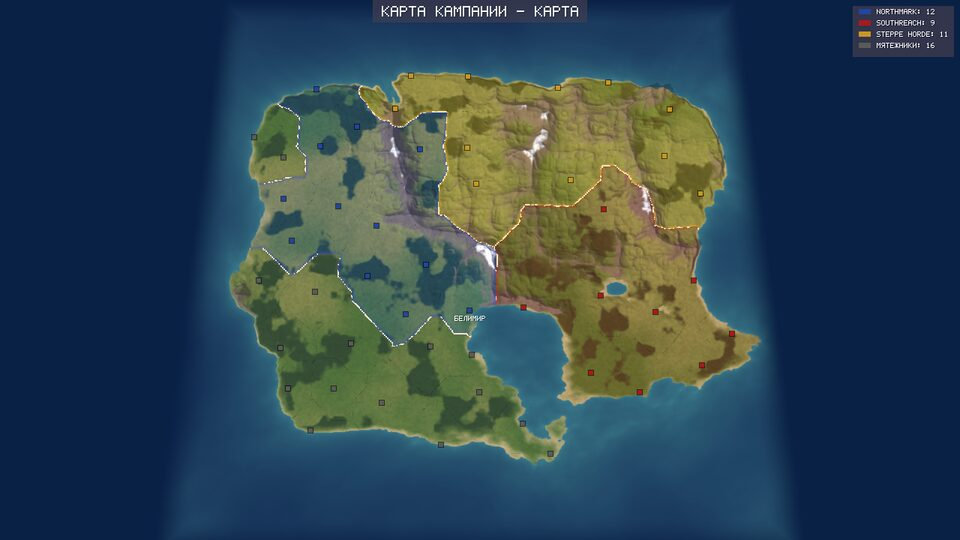
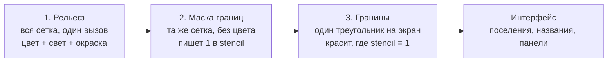

# Карта кампании: как она рисуется

Крейт `crates/rm_campaign_map` рисует глобальную карту кампании так, как это
делала Medieval II: не настоящий 3D-мир, а набор дешёвых приёмов, которые
выглядят как 3D. Запуск: `reforged-medieval --campaign` (на Windows —
`campaign-map.bat`), управление — в [how-to-run.md](../how-to-run.md#карта-кампании).

Издалека карта становится почти «политической»: камера смотрит круче вниз,
видны все страны и их границы.

## Из чего собрана картинка

| Приём | Номер в [smart-hacks.md](../adr/smart-hacks.md) | Где в коде | Подробно |
|---|---|---|---|
| Лист, приподнятый по сетке высот | H-01 | `src/mesh.rs` | [render.md](render.md) |
| Свет, тени и рельеф посчитаны заранее и лежат в текстурах | H-02 | `src/bake.rs` | [baking.md](baking.md) |
| Границы стран через stencil-буфер | H-03 | `src/gpu/mod.rs`, `shaders/border*` | [render.md](render.md#границы-стран-через-stencil-h-03) |
| Цвет владельца из таблицы: вся карта — один вызов, смена владельца — одно число | H-04 | `src/political.rs`, `shaders/terrain.frag` | [render.md](render.md#окраска-владельцев-h-04) |
| Горы вытянуты по высоте в 2,5 раза | H-05 | `src/map.rs` (`display_height`) | [generation.md](generation.md#горы-выше-чем-по-правде-h-05) |

## Части крейта

| Файл | Что делает | Нужна ли видеокарта |
|---|---|---|
| `src/map.rs` | Процедурная карта-заглушка: рельеф, моря, горы, регионы, названия | нет |
| `src/political.rs` | Кто владеет каким регионом, цвета фракций | нет |
| `src/bake.rs` | Запекание текстур: цвет земли, нормали, тени, поле границ | нет |
| `src/mesh.rs` | Сетка треугольников рельефа | нет |
| `src/camera.rs` | Камера карты: приближение, наклон, «что под курсором» | нет |
| `src/gpu/` | Загрузка в видеопамять и три прохода рисования | да |
| `shaders/` | Шейдеры на GLSL и готовый SPIR-V в `shaders/spv/` | — |
| `examples/preview.rs` | Картинка карты в файл без видеокарты | нет |

Всё, кроме `gpu/`, проверяется обычными тестами: `cargo test -p rm_campaign_map`.

## Кадр карты за три вызова рисования

Число вызовов не зависит ни от числа регионов, ни от числа фракций — их
может быть 50+, как задумано в проекте.

## Как карта попадает в приложение

Окно, проход рендера и буферы команд принадлежат приложению (`crates/rm_app`,
владелец — поток битвы). Карта встроена в него минимально:

- `rm_app/src/campaign.rs` — режим карты: мышь, клавиши, надписи поверх карты;
- `rm_app/src/campaign_app.rs` — окно и главный цикл этого режима (отдельно
  от цикла битвы, чтобы не трогать его);
- `rm_app/src/render/` — буфер глубины теперь со stencil, и если в кадре
  есть карта, вместо земли битвы рисуется она (`Renderer::load_campaign_map`,
  `Frame::campaign`).

## Что дальше

- **Настоящие регионы кампании.** Сейчас регионы, названия и владельцы
  придуманы генератором. Когда правила кампании (`rm_campaign`, поток D8)
  окажутся в `main`, карта будет строиться вокруг их поселений из
  `descr_rm_regions.txt` и показывать владельцев из их состояния.
- **Запекание офлайн.** Конвейер ассетов (`rm_assets`, поток C2) тоже
  умеет печь lightmap и normal map; когда он будет в `main`, текстуры
  карты можно печь им заранее и грузить с диска, а не считать при запуске.
- **Армии и поселения как модели**, а не квадратики интерфейса.
- **Огромная карта** — через `rm_streaming` (Virtual Texturing, Quadtree,
  Geometry Clipmaps, поток D2): эта карта рисуется поверх неё.
- Vulkan-код из `src/gpu/` переедет в `rm_render`, когда тот появится
  (см. [crate-map.md](../adr/crate-map.md)).
