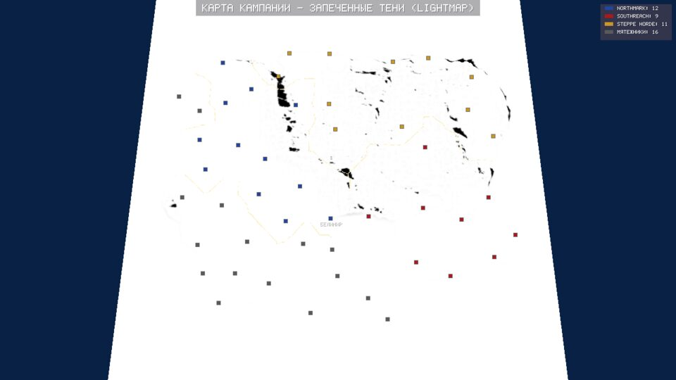

# Запекание текстур (H-02)

В игре видеокарта ничего не считает про свет: всё посчитано заранее и
лежит в текстурах (`src/bake.rs`). Так делала Medieval II, и так же
делаем мы. Сейчас запекание идёт при запуске (меньше секунды), позже
переедет в офлайн-конвейер ассетов (`rm_assets`).

| Текстура | Формат | Что в ней |
|---|---|---|
| albedo | RGBA8 sRGB, с mip-уровнями | Цвет земли без света. Альфа: 255 — суша, 0 — вода |
| normal | RGBA8, с mip-уровнями | Наклон поверхности: xyz, переведённые из −1..1 в 0..255 |
| light | RG8, с mip-уровнями | R — тень от гор, G — затенение впадин (ambient occlusion) |
| region | R8 целые, без mip | Номер региона: 0 — море, 1..254 — суша |
| border | RG8, без mip | R — расстояние до края региона (0..8 точек), G — номер региона за краем |

Карта 1024×1024 — это около 16 МБ текстур.

## Цвет земли

Каждая точка красится по высоте, крутизне и двум шумам («влажность» и
«лесистость»): песок у берега, сухая и сочная трава, пятна леса на
равнинах, скалы на крутых склонах и в горах, снег на вершинах (но не на
отвесных стенах). Вода — от бирюзовой у берега к тёмно-синей на глубине.
Сверху — мелкая зернистость ±6 %, чтобы трава не была однотонной.

## Нормали

Нормаль — направление «прочь от поверхности». Считается по разнице
соседних высот **показа** (с вытянутыми горами), чтобы горы освещались так
же круто, как выглядят. Сетка треугольников в 4 раза грубее текстур, и
мелкие складки рельефа видны только благодаря normal map.

## Тени

Из каждой точки идём шагами по направлению к солнцу (солнце с юго-запада,
невысоко — тени длинные). Если по пути рельеф выше луча — точка в тени.
Тень мягкая: чем глубже луч под горой и чем ближе гора, тем темнее. Идём,
пока луч не поднимется выше самой высокой горы.

Затенение впадин (AO): высота точки сравнивается со средней высотой вокруг
(квадрат 13×13). Во впадинах и долинах свет приглушён.

Солнце стоит на месте, поэтому тени не меняются. В шейдере свет собирается
так: `цвет × (рассеянный свет × AO + солнце × наклон к солнцу × тень)`.
Наклон к солнцу берётся из запечённой normal map.

## Поле границ

Для каждой точки суши — расстояние до края её региона и номер региона по
ту сторону. Считается «чамфер-преобразованием»: два прохода по сетке,
сверху вниз и снизу вверх, каждая точка берёт расстояние у соседа плюс
шаг (1 по прямой, √2 по диагонали). Расстояние передаётся только между
точками одного региона. Шейдер рисует по нему полосу цвета владельца вдоль
внутренней стороны границы страны.

## Mip-уровни

Для albedo, нормалей и теней строятся уменьшенные копии (каждая — среднее
из четырёх точек предыдущей). Вдали видеокарта берёт маленькую копию, и
карта не рябит. Номера регионов и поле границ уменьшать нельзя: номера не
усредняются.
